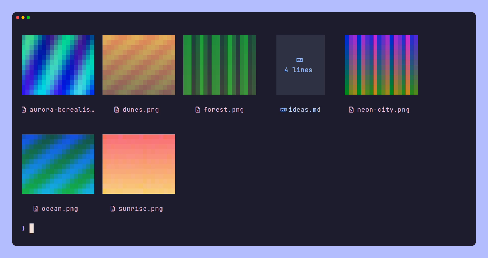
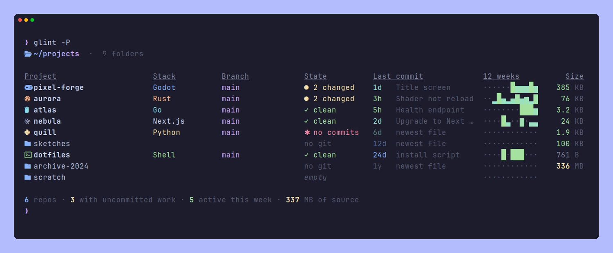
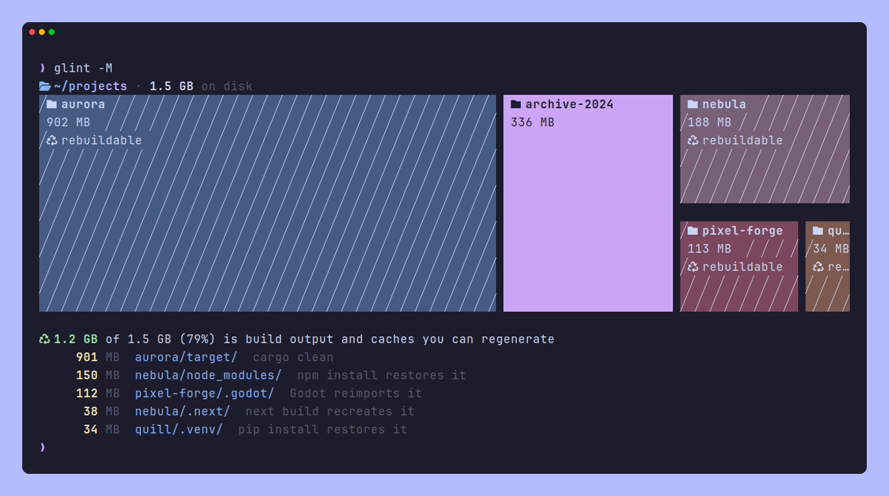

<div align="center">

# glint

A modern `ls` for people and for AI coding agents.

[](go.mod)
[](https://github.com/Vaspyyy/glint/tags)
[](LICENSE)


</div>

glint lists directories with icons, colors and git status, and goes a bit further than `ls` where that's useful: it can preview files, search their contents, show how a folder of projects is doing, and draw a map of what's using your disk. It also has a plain-text mode for coding agents that describes a repository in one call, using far fewer tokens than `tree`.

It's a single Go binary and starts in about 4 ms, so it's fine to alias over `ls`.

## Install

```sh
go install github.com/Vaspyyy/glint@latest
```

You'll need Go 1.26 or newer (older versions fetch the right toolchain on their own). Icons need a [Nerd Font](https://www.nerdfonts.com/); without one, use `--icons never`. Content search in the browser uses [ripgrep](https://github.com/BurntSushi/ripgrep), moving files to the trash uses `gio`, and media durations in `--peek` come from `ffprobe` if it's installed.

glint is developed on Linux. It also builds on macOS and the BSDs, but gets less testing there. Windows isn't supported yet.

For fish, this adds completions, a `gi` command that browses and then `cd`s to wherever you quit, and an optional listing after every `cd`:

```fish
glint --init fish --auto-ls | source    # in ~/.config/fish/config.fish
```

## Listing files

Plain `glint` prints a grid. The other views:

| Command | View |
| --- | --- |
| `glint -l` | Long listing with permissions, sizes, relative times and git status |
| `glint -T`, `glint -lT` | Tree, or a tree with the long columns (`-L 2` limits the depth) |
| `glint -p` | Adds a short description of each entry: the project type of a folder, the line count of a text file, image dimensions, media duration, archive contents |
| `glint -lcH` | Adds the last commit touching each entry and how often it changes |
| `glint -C` | A summary card for a project: stack, branch, languages, lines of code, TODOs |
| `glint --thumbs` | Image thumbnails, using the kitty graphics protocol or half-block characters |
| `glint -W` | Keeps the listing open and updates it as files change |
| `glint --json` | One JSON document for scripts and agents (see [JSON](#json)) |

The usual filters work with every view: `-a` for hidden files, `-D` and `-f` for only folders or only files, `-I '*.tmp'` to hide by pattern, `--gitignore`, `--changed` for files with uncommitted changes, and `--since 2h` for recently modified ones. Sorting is natural (`file2` before `file10`) and accent-aware; `-t`, `-S` and `-X` sort by time, size and extension.

<div align="center">

</div>

## Interactive browser

`glint -i` opens a full-screen browser with a preview pane. Code is syntax highlighted, markdown is styled, and images, archives and binary files get previews of their own.

<div align="center">

</div>

From the browser you can search inside files (ripgrep runs as you type, and Enter opens your editor at the matching line), jump to recently visited folders and to other projects, open a disk map of the current folder, and do the usual file operations. Deleting moves things to the trash, and asks before deleting permanently on drives that don't have one.

| Key | Action |
| --- | --- |
| arrows, `hjkl`, mouse | Move, open folders, go up |
| `/` | Filter names |
| `f`, `ctrl+f` | Search inside files |
| `P`, `ctrl+p` | Jump to a recent folder or project |
| `M` | Disk map of this folder |
| `r`, `d` | Rename, move to trash |
| `c`, `x`, `p` | Copy, cut, paste |
| `n`, `N` | New file, new folder |
| `space`, `a`, `y` | Select, select all, copy paths to the clipboard |
| `e`, `o` | Open in `$EDITOR`, open with the default app |
| `.`, `s`, `R` | Hidden files, sort order, reverse |
| `?` | Show all keys |

## Project dashboard

If you keep your projects in one folder, `glint -P` shows them side by side: the stack, the branch, uncommitted changes, the last commit, commit activity over the last twelve weeks, and the size of the source. Projects are sorted by recent activity; `-S` sorts by size and `-s name` by name.

<div align="center">

</div>

## Disk map

`glint -M` draws a treemap of disk usage, measured the same way `du` measures it. Build output and caches that can be regenerated, like `target/`, `node_modules/`, `.godot/` or `.venv/`, are hatched, and a short summary below the map says how much space they take and how to get them back.

<div align="center">

</div>

`glint -M -i` opens the same map interactively. Select a block with the arrow keys or the mouse, press Enter to look inside it, Backspace to go up, and `o` to open that folder in the browser.

## For coding agents

A ready-made Claude Code skill is in [`skill/SKILL.md`](skill/SKILL.md). Install it with `mkdir -p ~/.claude/skills/glint && cp skill/SKILL.md ~/.claude/skills/glint/`.

`glint -A` prints a plain-text description of a directory that's meant to be read by an AI agent. The first lines say what the project is, what state git is in, what changed and what's ignored. After that comes a tree that fits a line budget (200 lines by default, set with `--budget`).

```console
$ glint -A aurora --budget 40
/home/ada/projects/aurora — Rust · workspace · git main 2 uncommitted; HEAD eb6f4a3 3h ago: Shader hot reload
24 files, 76K (what git sees: tracked + untracked, excluding ignored)
changed: [M] crates/aurora-render/src/gpu.rs, [new] crates/aurora-render/src/upscale.rs
gitignored (hidden): target/
largest source files (excl. vendored/generated): crates/aurora-core/src/math.rs 125L, crates/aurora-render/src/gpu.rs 103L, …

assets/ (4 files, 37K)
  textures/ (3 files, 14K; png×3)
    ↳ checker.png marble.png sunset.png
  logo.png 96x96 24K
crates/ (13 files, 19K; newest file 1m ago) [2 changed]
  aurora-core/ (5 files, 9.6K; Rust · aurora-core)
    src/ (4 files, 9.5K)
      camera.rs 53L
      lib.rs 101L
      math.rs 125L
…
```

Folders with source code and documentation are expanded before media, generated data and vendored code, and shallow folders before deep ones. Runs of similar files are folded into one line, and the top level is always listed completely, so an agent can tell when something doesn't exist. In a folder that contains several repositories, each one gets a line with its stack and git state.

Given a file, `glint -A` lists its functions and types with line numbers, so an agent can read just the part it needs. This works for Go, Rust, Python, JavaScript and TypeScript, C and C++, Java, Kotlin, C#, GDScript, shell, Lua, Ruby and Markdown headings.

```console
$ glint -A crates/aurora-render/src/gpu.rs
crates/aurora-render/src/gpu.rs — 103L (last commit 2mo ago: Initial path tracer) [M], modified 1m ago
  3 pub struct Context
  8 pub fn create_device(ctx: &mut Context, input: &[f32]) -> Result<f32, Error>
  20 pub fn upload_scene(ctx: &mut Context, input: &[f32]) -> Result<f32, Error>
  32 pub fn dispatch(ctx: &mut Context, input: &[f32]) -> Result<f32, Error>
  44 pub fn readback(ctx: &mut Context, input: &[f32]) -> Result<f32, Error>
```

The header gives the path relative to the root of the repository you run glint in (absolute for a file outside it). When a signature doesn't show a symbol's name as it is, the name comes first: `187 globSet.match  func (g globSet) match(p string) bool` for a method, `5 init#2  func init()` for a second definition with the same name. The header path, a colon and that name make a ref (see [Refs](#refs)).

The map and the outline also mark what the current work changed, the way seek, recap and crux do (see [context](https://github.com/Vaspyyy/prism/blob/main/docs/context.md) in Prism):

```console
$ glint -A --outline internal
context: 1 changed symbol vs HEAD, 1 symbol changed on this branch since 453ae32
…
files/ (1 file, 183B; newest file 2m ago) [1 changed]
  files.go 16L [M]
    ↳ List:4 init#1:8 init#2:10 [changed] Repo:12 Repo.Open:14
render/ (1 file, 63B; newest file 5m ago) [1 branch]
  render.go 7L [branch]
    ↳ Draw:3 [branch] Clear:7
```

- Files committed on this branch since it left the default branch are marked `[branch]`, and folders count them (`[1 branch]`). Files with uncommitted changes keep their git status (`[M]`, `[new]`, …), which says more than a mark would.
- Symbols get `[changed]` (uncommitted) or `[branch]`, in `glint -A <file>` and with `--outline`. The symbols of a new, added or renamed file aren't marked: its `[new]`, `[A]` or `[R]` already says they're all new at that path.
- The `context:` line at the top says what the marks are based on, one line for the whole run. It counts against the budget by taking the place of a glance line, never of a listed file.

Context only marks: the same entries are listed with it or without it. It costs a few git commands, which run while glint reads the tree and look only at what's listed: `glint -A <file>` asks git about that file, and a map without `--outline` only needs to know which files changed. Plain listings (`glint -l`, `glint -T`, …) never load it, and `--no-context` or `PRISM_NO_CONTEXT=1` turns it off, for scripts and tests that compare outputs.

On a Rust workspace with about 4,000 files, `glint -A` came to roughly 2,900 tokens. For comparison, `tree -L 2` was about 13,000 and `git ls-files` about 50,000, and neither includes git state or line counts. The format was refined over several rounds of comparisons in which different models used glint alongside `ls`, `tree`, `git` and `du` on real projects.

To have your agent use it, add something like this to its instructions (for example `AGENTS.md`):

```md
To explore directories, prefer `glint -A [dir]` over `ls`, `tree`, `find` or `git ls-files`.
`glint -A <file>` lists a file's symbols with line numbers.
```

## Refs

glint, seek, recap and crux name files, symbols and locations the same way, so anything one of them prints can be handed to another as is:

- `internal/files/files.go`: a file
- `internal/files/files.go:List`: a symbol, by its qualified name (`Repo.Open` for a method, `outer.inner` for a nested function)
- `internal/files/files.go:73`: a line (`73:5` with a column, `73-107` a range); tools that take a symbol use the innermost one containing it
- `main.go:run@b681ef1`: a symbol as it was in a commit; `lib.cpp:parse#2`: the second of two definitions with the same name

Paths are relative to the repository root. The format is specified in [Prism](https://github.com/Vaspyyy/prism/blob/main/docs/refs.md).

## JSON

`--json` prints one JSON document per run: the envelope glint shares with seek, recap and crux, specified in [Prism](https://github.com/Vaspyyy/prism/blob/main/docs/output.md). It has `schema`, `tool`, `version`, `args` and `repo` (root, branch, HEAD, uncommitted changes), then `result`, or `error` when the run failed.

- `glint --json [paths]` puts the listing in `result.items` (always present, `[]` for an empty folder): each entry's name, path (as listed, relative to `result.dir`, the working directory, like `ls`), type, kind, size, mode, modification time, owner, git status and a symlink's `link_target`, plus the description, last commit or folder size with `-p`, `-c` and `--du`. With `-T`, folders hold their contents in `children`. A file given without `-A` is listed as one entry.
- `glint -A --json <file>` puts one file in `result.file`: its `path` (relative to the repository root, absolute outside it, like the text header), `lines`, `size`, `modified`, `mode`, `kind` (`image`, `binary`, `vendored` or `generated`; left out for plain text), `image` (an image's size), `link_target`, `git` (`modified`, `untracked`, `ignored`, …; left out when the file is clean), `last_commit`, `marks` (`changed` or `branch` when the current work changed the file) and `symbols`. Each symbol has a `ref` that seek, recap and crux accept (`internal/files/files.go:globSet.match`), and `marks` when it changed. The envelope's `context` says what the marks are based on, counting that file's changes; it's `null` with `--no-context` or `--no-git`, and for listings, which don't load context. The `commits` count in `last_commit` is only counted with `-H`, in listings too.
- Failures are an envelope too, with `error.code` `usage` (bad arguments) or `failed` (anything else, such as a missing path), and glint exits with the same code as without `--json`. A missing path fails the whole run instead of listing the other paths.
- Views that show more than a listing (`-P`, `-C`, `-M`, `--thumbs`, `-i`, `-W`, and `-A` with a directory) have no JSON output and fail with a `usage` error. `--help`, `--version` and `--init` still print text.
- Lists are capped at 10,000 entries, and `truncated` says when that cut something.

**Breaking change:** up to glint 0.7.0, `glint --json` printed a bare array of entries. That array is gone: the entries are now `result.items` inside the envelope, so a script that read the array needs `.result.items` (for example `glint --json | jq '.result.items[]'`). A symlink's target, which was `target`, is now `link_target`, since `target` holds refs in every tool's JSON.

```console
$ glint -A --json internal/textw/textw.go
{
  "schema": "prism/1",
  "tool": "glint",
  "version": "0.7.0",
  "args": ["-A", "--json", "internal/textw/textw.go"],
  "repo": { "root": "/home/ada/projects/glint", "git": true, "branch": "main", "dirty": false, … },
  "context": { "applied": [], "changed": { "base": "HEAD", "files": 0, "uncommitted": 0, "branch": 0 } },
  "result": {
    "file": {
      "path": "internal/textw/textw.go",
      "lines": 111,
      "size": 2122,
      "modified": "2026-11-03T05:32:30+01:00",
      "mode": "-rw-r--r--",
      "last_commit": { "hash": "e06701b", "subject": "Add text width helpers", "author": "Ada", "time": "2026-11-03T05:32:30+01:00", "commits": 1 },
      "symbols": [
        {
          "ref": "internal/textw/textw.go:Width",
          "path": "internal/textw/textw.go",
          "name": "Width",
          "kind": "func",
          "line": 15,
          "end": 25,
          "sig": "func Width(s string) int"
        },
        …
      ]
    }
  },
  "links": [],
  "next": [],
  "truncated": null
}
```

## Configuration

glint reads `~/.config/glint/config.toml` if it exists; `glint --init config` writes a commented starting point. Each key is the long name of a flag, and `[themes.NAME]` sections define color schemes:

```toml
theme = "midnight"
classify = true
ignore = ["__pycache__", "*.pyc"]

[themes.midnight]
extends = "tokyonight"
blue = "#7aa2f7"
purple = "#bb9af7"
```

The built-in themes are `catppuccin` (the default), `tokyonight`, `gruvbox`, `nord`, and `wal`, which follows [pywal](https://github.com/dylanaraps/pywal). Default flags can also be set in the `GLINT_OPTS` environment variable. `glint --help` lists every option.

## How it works

Most of glint's speed comes from doing little at startup. It avoids dependencies with expensive initialization, which is why the terminal UI, the color handling and the syntax highlighter are written by hand rather than using Bubble Tea, Lip Gloss or Chroma. Each listing runs `git status` once and derives folder status from it, file metadata is read in parallel, and thumbnails reuse the cache your file manager has already built.

```
internal/
  agent/    glint -A
  cli/      flags, help, watch mode, shell integration
  config/   config file and custom themes
  dash/     project dashboard
  fsx/      reading, sorting and measuring files
  git/      status and history
  icons/    file icons and types
  img/      image decoding and thumbnails
  peek/     short descriptions of file contents
  project/  project type detection
  render/   the different views
  textw/    text width handling
  theme/    colors
  tui/      interactive browser
```

## License

GPL-3.0-or-later. See [LICENSE](LICENSE).
